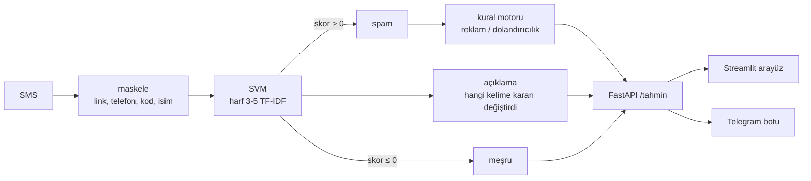
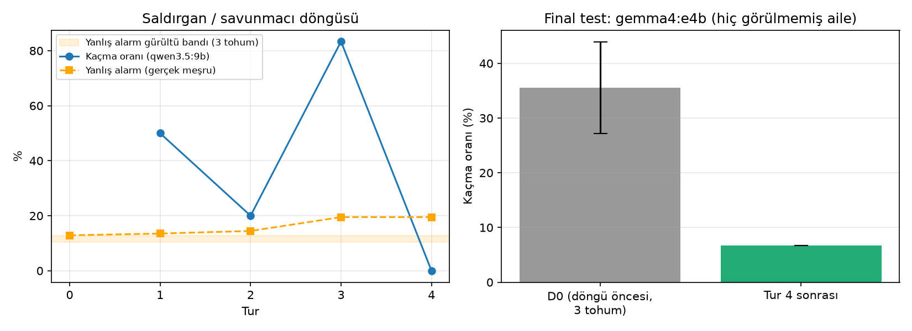

# SMS Dolandırıcılık Tespiti

Türkçe SMS'lerde **spam / dolandırıcılık** tespiti: veri toplama ve maskelemeden model seçimine, saldırgan bir LLM'e karşı dayanıklılık testinden FastAPI, Streamlit ve Telegram botuna kadar uçtan uca bir proje.

Workintech Data Science bootcamp projesi · **Esra Sezgin** ve **Salih Can Türk** · Kasım 2026

> Kısa cevap: nihai model harf parçası TF-IDF + doğrusal SVM. Kilitli test setinde **F1 0.972**. Ama gerçek kurumsal SMS'lerde ve LLM'in yazdığı dolandırıcılıkta model daha zorlanıyor. Bu README bunu da saklamadan anlatıyor.

---

## Sonuçlar bir bakışta

| Ölçüm | Nihai model (SVM E) |
|---|---|
| Kilitli `tr_test` (116 mesaj, tek bakış) | **F1 0.972** · yanlış alarm 1/62 · kaçan spam 2/54 |
| Zor set: gerçek kurumsal SMS, göndericiye göre birini dışarıda bırak (131 mesaj) | F1 0.923 · yanlış alarm 6/67 · dolandırıcılık 10/10 |
| Hiç görülmemiş göndericilerden gerçek meşru kurumsal SMS (97) | yanlış alarm **%7.2** |
| Hiç görülmemiş bir LLM'in (gemma4) yazdığı dolandırıcılık (60) | yakalama **%58** |
| İngilizce (UCI, 5574 mesaj) | F1 0.344: **model yalnızca Türkçe için geçerli** |

---

## Nasıl çalışıyor



- **Maskeleme önce gelir.** Model eğitimde hiç gerçek link ya da numara görmedi. Canlıda da mesaj önce `src/maskele.py`'den geçer.
- **Model karar verir, kural motoru türü söyler.** Spam denen mesajın reklam mı dolandırıcılık mı olduğunu kurallar belirler (zor sette dolandırıcılık türü 9/10).
- **Bot mesajları kaydetmez.**

---

## Projenin hikâyesi: 6 bulgu

### 1. Test setinde %97, gerçek hayatta yanlış alarm yağmuru
İlk modeller test setinde 0.96–0.98 F1 aldı. Hata analizi şunu gösterdi: model **"resmi/kurumsal dil = spam"** öğrenmiş, çünkü eğitimdeki spam'in neredeyse tamamı kurumsal reklam, meşrunun çoğu ise gündelik sohbet. Gerçek banka ve kargo bildirimlerinden oluşan bir **zor set** topladık. Yalnızca standart veriyle eğitilen model bu sette meşru mesajların **41/67'sine** alarm verdi.

### 2. Her veri kaynağı farklı bir işe yarıyor (XLM-R, zor set, göndericiye göre LOSO)

| Deney | Eğitime eklenen | Yanlış alarm | Dolandırıcılık | F1 |
|---|---|---|---|---|
| A | – | 41/67 | 5/10 | 0.720 |
| C2 | sentetik (LLM'le üretilmiş, kalite kontrollü) | 39/67 | 9/10 | 0.759 |
| B | gerçek kurumsal mesaj | 6/67 | 5/10 | 0.906 |
| D | gerçek + sentetik | 10/67 | 9/10 | 0.912 |
| **E** | gerçek + sentetik + elle etiketlenmiş 58 kurumsal SMS | **6/67** | **10/10** | **0.947** |

Gerçek kurumsal mesaj yanlış alarmı çözüyor, sentetik veri dolandırıcılığı. Sentetik verinin **nasıl** üretildiği de önemli: linklerin dengesiz dağıldığı ilk sürüm (v1) yanlış alarmı artırdı.

### 3. Otomatik etiketleme tuzağı
1490 kişisel kurumsal SMS'i kuralla etiketledik ("RET/iptal yazısı varsa reklam"). Yanlış alarm neredeyse sıfıra indi, ama **dolandırıcılık yakalama 9/10'dan 2/10'a çöktü**. Model içeriği değil kuralı öğrenmişti: "RET yoksa meşru". Dolandırıcılar RET yazmaz. Kuralın baktığı ifadeyi metinden kesince yakalama 7/10'a çıktı.

### 4. Saldırgan LLM ile kırmızı/mavi takım döngüsü
Yerel bir LLM (qwen3.5 9B, Ollama) dolandırıcılık SMS'i yazıyor. Modeli geçenler eğitime ekleniyor, model yeniden eğitiliyor. 4 tur sonra final sınavı, döngüyü hiç görmemiş başka bir model ailesi (gemma4) yapıyor.



- Görülmemiş saldırgana karşı kaçma oranı **%27–43'ten %7'ye** düştü (3 tohumla ölçülen gürültü bandının çok dışında).
- **Bedeli:** gerçek meşru mesajlarda yanlış alarm %11'den %19.5'e çıktı. Model sadece "bu da dolandırıcılık" örneği gördü.
- **v3:** meşru karşı ağırlık ve ikinci saldırgan (aya-expanse). Yanlış alarm artık bandın içinde, ama dayanıklılık kazancı daha küçük. Önceden yazdığımız kriter v3'ü **reddetti**. Kriteri sonradan değiştirmedik.

### 5. Daha çok veri her zaman daha iyi değil
Kişisel SMS havuzunu (679 mesaj) son modele eklemeyi, hiç görülmemiş gerçek mesajlarda test ettik. Yanlış alarm 4.5 puan düştü, ama **LLM dolandırıcılığını yakalama 25 puan çöktü**. Havuzdaki gerçek banka bildirimleri modele "resmi kurum dili → meşru" öğretti; dolandırıcılar da tam bu dili taklit ediyor. Önemli olan verinin miktarı değil, **ne öğrettiği**.

### 6. Model seçimi: 278M parametreli XLM-R mi, doğrusal SVM mi?

| | SVM E | XLM-R E |
|---|---|---|
| Zor set F1 / yanlış alarm / dolandırıcılık | 0.923 / 6 / 10 | 0.940 / 7 / 10 |
| Kilitli tr_test F1 | **0.972** | 0.953 |
| Görülmemiş gerçek meşru SMS'te yanlış alarm | **%7.2** | %12.4 (9–14) |
| Görülmemiş LLM saldırısını yakalama | %58 | %66 (52–78) |

Seçim kuralı sonuçlardan **önce** yazıldı: önce dolandırıcılık, sonra yanlış alarm, fark gürültü seviyesindeyse basit olan. İki bağımsız sınav da aynı yönü gösterdi: **SVM**. CPU'da milisaniyede çalışıyor, her eğitimde aynı model çıkıyor (XLM-R tohuma göre 26 puan oynuyor), kararı açıklanabilir.

---

## Sınırlar

- Görülmemiş bir LLM'in yazdığı dolandırıcılığın **~%40'ı kaçıyor**. Gerçek meşru kurumsal SMS'lerin **~%7'sine** alarm veriliyor.
- Gerçek Türkçe dolandırıcılık örneği çok az: zor sette 10 mesaj, 1 mesaj = 10 puan.
- "Gerçek kullanım" ölçümleri tek kişinin gelen kutusundan. Dolandırıcılık sınavı LLM yazımı, gerçek dolandırıcı değil.
- Yalnızca Türkçe (İngilizce F1 0.344).
- Kural motorunun tür doğruluğu, kuralların yazıldığı zor sette ölçüldü (iyimser).

Ayrıntılı hata listesi: [`docs/bilinen-hatalar.md`](docs/bilinen-hatalar.md)

---

## Kurulum ve çalıştırma

```bash
# --- kurulum (Python 3.12+) ---
python -m venv .venv
source .venv/bin/activate              # Windows: .venv\Scripts\activate
pip install -r requirements.txt fastapi uvicorn streamlit requests

# --- model: models/svm_v1.joblib (repoda yok, aşağıya bakın) ---

# --- API ---
uvicorn src.api:app --reload           # http://127.0.0.1:8000/docs

# --- arayüz (ayrı terminal) ---
streamlit run src/arayuz.py

# --- Telegram botu (ayrı terminal, API açıkken) ---
export TELEGRAM_TOKEN=...              # BotFather'dan
python src/telegram_bot.py

# --- testler ---
python -m pytest
```

**Docker ile** (API + arayüz birlikte, model `./models` klasöründen bağlanır):

```bash
docker compose up --build              # API :8000, arayüz :8501
```

**Örnek istek:**

```bash
curl -X POST http://127.0.0.1:8000/tahmin -H "Content-Type: application/json" \
     -d '{"mesaj": "Kargonuz teslim edilemedi, adresinizi güncelleyin: bit.ly/x"}'
# → {"etiket": "spam", "skor": ..., "aciklama": [{"kelime": ..., "etki": ...}], "tur": "dolandırıcılık"}
```

**Model dosyası neden repoda yok:** eğitim verisinin bir kısmı maskelenmiş kişisel SMS'lerden oluşuyor. Model dosyası ve ham veri repoya girmiyor. Eğitim tarifi (deney E) [`PROJECT.md`](PROJECT.md)'de.

### Deneyleri tekrar üretmek

| Script | Ne yapar |
|---|---|
| `python -m src.bol` | Grup duyarlı train/test bölmesi (benzer şablonlar aynı tarafta) |
| `python -m src.baseline` | NB / LR / SVM × kelime / harf TF-IDF, 5 katlı grup CV |
| `python -m src.zor_deney E_v2` | XLM-R, zor set, göndericiye göre LOSO |
| `python -m src.son_model` | XLM-R E (araştırma modeli) |
| `python -m src.dongu` · `python -m src.dongu_v3` | Saldırgan / savunmacı döngüsü (Ollama gerekir) |
| `python -m src.havuz_deney` | Kişisel havuz deneyi + SVM / XLM-R karşılaştırması |

Deneyler MLflow'a (`sqlite:///mlflow.db`) kaydedilir: `mlflow ui --backend-store-uri sqlite:///mlflow.db`

---

## Veri ve gizlilik

| Kaynak | Kullanım |
|---|---|
| [turkishSMS-ds](https://huggingface.co/datasets/akuysal/turkishSMS-ds) (HF) | Ana eğitim ve kilitli test |
| Zor set (131 gerçek kurumsal SMS) | Elle toplandı, maskelendi, etiketlendi ([`docs/zor-test.md`](docs/zor-test.md)) |
| Sentetik (96) | LLM ile üretildi, kalite kontrollü, **sadece eğitimde** |
| Kişisel kurumsal SMS (58 etiketli + havuz) | Maskelendi; havuz yalnızca sahibinin bilgisayarında |
| [UCI SMS Spam](https://www.kaggle.com/datasets/uciml/sms-spam-collection-dataset) | İngilizce dış test |

- Maskelenmemiş veri, model dosyaları ve MLflow kayıtları repoya girmez (`.gitignore`).
- Test seti kilitli: model ve ayar seçiminde kullanılmadı.
- Etiketleme kuralları: [`docs/etiket-rehberi.md`](docs/etiket-rehberi.md)

---

## Proje yapısı

```
src/        maskeleme, temizlik, modeller, deneyler, API, arayüz, bot
tests/      pytest (maskele, temizle, bol, baseline, kurallar)
notebooks/  keşif ve deney kayıtları (arşiv)
docs/       zor test raporu, etiket rehberi, bilinen hatalar, döngü sonuçları
PROJECT.md  kararlar, deney protokolü, günlük sonuçlar (projenin tek doğruluk kaynağı)
```

## Çalışma şekli

İki kişi, iki hafta. Her iş kendi dalında, her PR'ı diğer kişi inceleyip birleştirdi. Kararlar koddan önce `PROJECT.md`'ye yazıldı. Model seçim kriterleri sonuçlardan önce konuldu ve sonuç beklenmedik çıktığında da değiştirilmedi.
